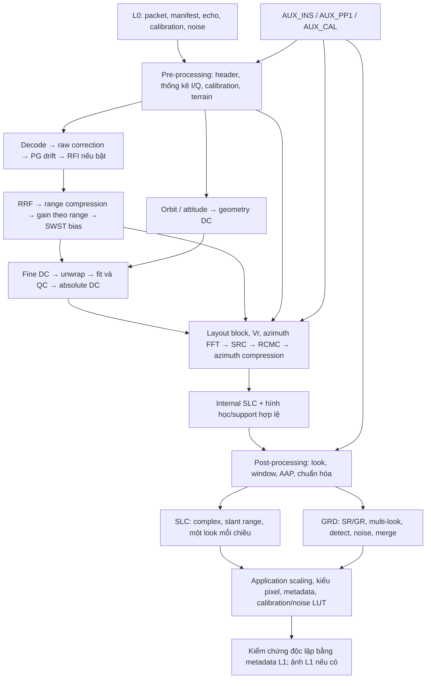

# Workflow tái hiện Sentinel-1 L0 → L1 theo DAD

Tài liệu này là bản diễn giải luồng xử lý để phát triển dự án, ưu tiên
**Stripmap → SLC**, bao gồm cảnh S4/VV trong `product_1`. Mục tiêu là giữ
thứ tự xử lý, nguồn tham số, hình học, chuẩn hóa và điều kiện của từng bước
để các lần triển khai sau không mất context.

Nguồn chính: [Sentinel-1 Level 1 Detailed Algorithm Definition](<../references/ESA2022_Sentinel-1 Level 1 Detailed Algorithm Definition_bookmarked.pdf>),
SEN-TN-52-7445, DI-MPC-IPFDPM / MPC-0307, Issue/Revision **2/5**, ngày
**17/11/2022**, 166 trang PDF. Các ký hiệu `§`, `Eq.`, `Figure`, `Table`
dưới đây dẫn đến mục, phương trình, hình và bảng trong bản DAD này; số trang
in dạng `6-20` là số trang của tài liệu, khác số trang trong trình xem PDF.

Đây là workflow thuật toán, **không phải xác nhận repo đã thực hiện đầy đủ
IPF**. Mục 16 chỉ nơi có code liên quan; tình trạng phải kiểm tra lại khi sửa.
Các checklist và cách lưu provenance là hướng dẫn triển khai của dự án.
Thông tin bộ dữ liệu và giới hạn cục bộ được khảo sát ngày 20/10/2026; xem
[AGENTS.md](../AGENTS.md) để biết đầy đủ tên file và phiên bản AUX.

## Mục lục

1. [Phạm vi sản phẩm và quy tắc nguồn dữ liệu](#1-phạm-vi-sản-phẩm-và-quy-tắc-nguồn-dữ-liệu)
2. [Sơ đồ phụ thuộc tổng thể](#2-sơ-đồ-phụ-thuộc-tổng-thể)
3. [Quy ước miền dữ liệu, trục và đơn vị](#3-quy-ước-miền-dữ-liệu-trục-và-đơn-vị)
4. [Chuẩn bị input và chọn cấu hình](#4-chuẩn-bị-input-và-chọn-cấu-hình)
5. [Pre-processing](#5-pre-processing--dad-4)
6. [Giải mã và hiệu chỉnh raw](#6-giải-mã-và-hiệu-chỉnh-raw--dad-9194)
7. [Range processing](#7-range-processing--dad-61-và-622)
8. [Doppler centroid estimation](#8-doppler-centroid-estimation--dad-5)
9. [Hình học, vận tốc hiệu dụng và layout block](#9-hình-học-vận-tốc-hiệu-dụng-và-layout-block)
10. [Azimuth focusing](#10-azimuth-focusing--dad-6263)
11. [Timing, support hợp lệ và slicing](#11-timing-support-hợp-lệ-và-slicing)
12. [Post-processing để tạo SLC chuẩn](#12-post-processing-để-tạo-slc-chuẩn--dad-7)
13. [Các nhánh GRD, TOPSAR, WV và dual-pol](#13-các-nhánh-grd-topsar-wv-và-dual-pol)
14. [Sổ chuẩn hóa và nguồn tham số](#14-sổ-chuẩn-hóa-và-nguồn-tham-số)
15. [Checklist triển khai và chẩn đoán sai lệch](#15-checklist-triển-khai-và-chẩn-đoán-sai-lệch)
16. [Đối chiếu với repo hiện tại](#16-đối-chiếu-với-repo-hiện-tại)
17. [Điểm dễ đọc nhầm trong DAD](#17-điểm-dễ-đọc-nhầm-trong-dad)

## 1. Phạm vi sản phẩm và quy tắc nguồn dữ liệu

DAD §3 chia sản phẩm L1 thành SLC và GRD, áp dụng cho SM, IW, EW và WV.
IW/EW dùng TOPSAR. Có ba mức kết quả cần phân biệt:

| Mức kết quả | Ý nghĩa |
|---|---|
| Raw đã giải mã | I/Q trong miền thời gian, chưa được focus. |
| Internal SLC | Đầu ra khối lấy nét §6, còn ở dạng complex/slant range; là input của §7. |
| SLC L1 đầu ra | Đã qua post-processing áp dụng cho SLC, chuẩn hóa/scaling, chọn vùng hợp lệ, chuyển kiểu và có metadata mô tả. |

Ảnh nhìn sắc nét hoặc một GeoTIFF complex chưa đủ chứng minh đạt toàn bộ
chuẩn sản phẩm Sentinel-1 SAFE. Cũng không đánh đồng SLC với ảnh biên độ
`abs(SLC)`, ảnh cường độ `abs(SLC)**2`, ảnh dB hay ảnh quick-look 8-bit.

Ranh giới nguồn dữ liệu của dự án:

- **L0**: raw echo/calibration/noise, header, thời gian, cấu hình phát/thu,
  orbit/PVT và attitude downlink có sẵn, định danh cảnh từ manifest.
- **AUX_INS / AUX_PP1 / AUX_CAL**: đặc tính thiết bị, cấu hình processor,
  mô hình/LUT hiệu chỉnh và hiệu chuẩn tương ứng.
- **L1 tham chiếu**: dùng đánh giá kết quả trong test/chẩn đoán. Không lấy
  hệ số Doppler/FM rate, bias, timing, orbit, terrain height, kích thước hay
  LUT L1 đưa ngược vào quá trình tạo ảnh.
- DAD còn cho phép orbit file và DEM làm đầu vào. Nếu cần mở rộng demo tới
  các nguồn đó, phải xác lập dữ liệu độc lập và provenance; thiếu chúng phải
  ghi rõ giới hạn. Không lấy bản sao orbit/terrain height trong L1 để lấp chỗ trống.
- Tham số nội bộ phải có căn cứ thuật toán, đơn vị và giới hạn áp dụng;
  không tinh chỉnh theo L1 rồi gọi là giá trị suy ra từ L0/AUX.

Ngoại lệ nghiên cứu do người dùng yêu cầu: CLI
`workflows/sentinel-1/estimate_doppler_centroid.py` suy layout DCE từ L1 để
đối chiếu riêng cảnh S4. Việc dùng L1 cho layout/time alignment được ghi
rõ trong README/JSON; tín hiệu và geometry DC vẫn từ L0. Theo yêu cầu tiếp
theo, cờ `--l1-input-corrections` còn dùng bias/replica/PG/EAP tính sẵn từ L1
để chuẩn bị input DCE chẩn đoán; xem README mục tương ứng để biết nguồn,
quy ước reciprocal PG, support sau bù internal delay và các giới hạn.
Ngoại lệ này không thay đổi quy tắc nguồn dữ liệu của pipeline tạo SLC.

## 2. Sơ đồ phụ thuộc tổng thể

Sơ đồ dưới đây tổng hợp Figure 3-3, 5-1, 5-2, 6-1 và 7-2. Range compression
phục vụ DCE và focus có thể dùng chung kết quả nếu cùng cấu hình/hiệu chỉnh.



Thứ tự mục trong DAD không có nghĩa mọi bước chạy một lần theo số mục:
§9 là thuật toán dùng chung; decoding/correction xuất hiện tại preprocessing,
DCE và SLC processing. DCE cần range-compressed data, nên không thể đặt nó
trước mọi range processing chỉ vì §5 đứng trước §6.

## 3. Quy ước miền dữ liệu, trục và đơn vị

Đối chiếu Appendix B, Table B-1 trước khi thay đổi FFT, transpose hoặc filter.

| Ký hiệu / dữ liệu | Quy ước dùng trong workflow |
|---|---|
| `s[azimuth, range]` | Quy ước ma trận của tài liệu này: dòng là echo theo slow time, cột là mẫu range. Xác nhận thứ tự trong API thực tế. |
| `τ` | Fast time / thời gian truyền hai chiều tương ứng slant range, đơn vị giây. |
| `η` | Slow time / thời gian azimuth, giây; phải ghi rõ receive/latch/acquisition hay zero-Doppler. |
| `Fr`, `Fa` | Tần số lấy mẫu range complex và azimuth, Hz; SM có `Fa=PRF=1/PRI`. |
| `Δτ`, `Δη` | Khoảng lấy mẫu: `1/Fr`, `1/Fa`, đơn vị giây. |
| `fτ`, `fη` | Tần số range và azimuth, Hz. Tần số Doppler vật lý khác nhãn FFT baseband khi có ambiguity. |
| `R`, `R0` | Slant range tức thời và slant range tại closest approach; không tráo hai loại trong SRC/RCMC/filter. |
| `λ`, `f0` | Bước sóng và tần số radar; `λ=c/f0`, lấy đặc tính radar từ AUX_INS. |
| `Vr` | Vận tốc radar hiệu dụng, m/s; phụ thuộc range và thời gian block. |

Trong DAD, **range line** là chuỗi fast-time của một echo; **azimuth line**
là chuỗi slow-time tại một vị trí range. Không dịch cả hai thành “dòng ảnh”
rồi chọn cùng một axis FFT.

| Công đoạn | Input → working → output |
|---|---|
| Decode, raw correction, PG | Packet → I/Q → `(η, τ)` |
| Range compression | `(η, τ)` → `(η, fτ)` → `(η, τ)` |
| Fine DCE | `(η, τ)` → ACCC/ước lượng theo range → polynomial theo range và block time |
| Azimuth FFT | `(η, τ)` → `(fη, τ)` |
| SRC | `(fη, τ)` → `(fη, fτ)` theo range segment → `(fη, τ)` |
| RCMC | `(fη, τ)` → nội suy theo range → `(fη, τ)` |
| Azimuth compression | `(fη, τ)` → nhân filter, azimuth IFFT → `(η, τ)` |
| Post-processing | FFT/look/window/IFFT theo từng chiều; SLC giữ complex, GRD mới detect. |

Giữ các quy ước xuyên suốt:

- `R=cτ/2`, `ΔR=c/(2Fr)`. Không dùng `c*Fr/2` làm pixel spacing.
- Đọc đơn vị XML/XSD: receiver variation trong §9.2.3 dùng **microsecond**;
  tần số Hz, thời gian s và góc degree/radian phải đổi ở ranh giới rõ ràng.
- Ghi quy ước dấu FFT, thứ tự bin, `fftshift`, liên hợp và dấu pha.
- NumPy mặc định chuẩn hóa IFFT bằng `1/N`; không chia thêm lần nữa chỉ vì
  §9.20 nhắc rằng một số thư viện FFT cần chia thủ công.
- Mọi polynomial phải đi kèm biến độc lập, origin (`τ0`/`t0`), đơn vị,
  thứ tự hệ số và thời điểm block. Hệ số theo giây không dùng trực tiếp cho mét.

## 4. Chuẩn bị input và chọn cấu hình

**Input:** `~/sar_data/focusing_data/product_1/{level-0,level-1,auxiliary}`.
Tên và cây thư mục chi tiết nằm trong [AGENTS.md](../AGENTS.md).

1. Kiểm kê file thực có; đọc cả manifest L0 và AUX. Manifest L1 được đọc ở
   nhánh tham chiếu để biết nguồn/version mà IPF dùng.
2. Xác nhận Sentinel-1A, SM/S4, VV; đối chiếu orbit, datatake, acquisition time.
   Các XML L1 đã được đặt phẳng; đường dẫn `./annotation/...` trong manifest
   không tồn tại nguyên dạng ở đây.
3. Chọn AUX theo satellite, validity, generation/version, mode, product,
   swath và polarisation. Không chọn entry đầu tiên trong XML.
4. Với S4 SLC: AUX_PP1 `productList/product[productId=SM_SL1__1]`;
   các danh sách bên trong chọn `swath=S4`. AUX_INS chọn swath, pulse,
   RX polarisation, internal calibration; AUX_CAL chọn S4/VV.
5. Lưu danh tính file, schemaVersion, nhánh XML, đơn vị và giá trị thực dùng.
   Phân biệt “cờ AUX yêu cầu bật” với “code đã thực hiện hiệu chỉnh đó”.
6. Xác định nguồn orbit/attitude/terrain, độ phủ thời gian và phương pháp nội suy.
   Thiếu nguồn phải báo giới hạn trước khi đánh giá parity với IPF.
7. Xác định phạm vi output cần làm: internal SLC, SLC chuẩn hay thêm GRD.

Các ràng buộc thực tế đã quan sát:

- L0 có một `.dat` VV và manifest; manifest còn tham chiếu VH/annot/index
  không có. Chưa kết luận có đủ pulse calibration/noise cần thiết trước khi
  khảo sát packet trong `.dat`.
- L1 chỉ có manifest và bốn XML VV, **không có measurement TIFF**.
- AUX_INS cục bộ là `G20251015T084505`, L1 dùng `G20250116T092837`;
  ghi nhận provenance, không tự quy khác generation thành lỗi validity hoặc
  nguyên nhân sai số. Xem quy tắc chọn AUX trong AGENTS.md.
  AUX_PP1/AUX_CAL trùng tên manifest L1.
- Manifest L1 ghi dùng AUX_RESORB, nhưng file EOF đó không có cục bộ.
- Notebook hiện cấu hình S6 ngày 26/12/2025; không dùng `SCENE_CHUNKS=(13,14)`
  hoặc toàn bộ `s6_parameters.py` cho S4 chỉ bằng đổi đường dẫn.

**Đầu ra checkpoint:** bản mô tả input/cấu hình có provenance và danh sách
nguồn còn thiếu; đủ để tái tạo đúng lựa chọn cấu hình trong lần chạy sau.

## 5. Pre-processing — DAD §4

### 5.1. Header validation và timeline — §4.3, Table 4-1

Mục đích là xác lập giá trị header đáng tin, phát hiện bit error, missing
line/gap và kiểm tra trình tự echo/calibration/noise theo instrument timeline.

1. Đọc primary/secondary header; chuyển field code sang giá trị vật lý theo
   quy luật/LUT đúng. DAD dẫn chi tiết packet/decoding sang tài liệu PDU [A-6].
2. Dùng majority polling trong đúng phạm vi hằng: data take, swath hoặc loại
   packet. Có các field được phép thay đổi, ví dụ SWST/SWL; cần phân biệt
   thay đổi thật với bit error.
3. Cross-check Packet Sequence Count, Space Packet Count, PRI Count và
   timeline; xác nhận swath, channel, signal type, chirp và cấu hình nhận.
4. Kiểm tra số mẫu giải mã so với Number of Quads, SWL và Range Decimation;
   xử lý ảnh hưởng decimation/suppressed transients theo packet specification.
5. Dựng segment khi cấu hình thay đổi và giữ ánh xạ packet → echo index → thời gian.

§4.3.1 phân biệt hai tình huống sau khi đã xử lý bit error:

| Counter increment | Diễn giải |
|---|---|
| Cả ba tăng 1 | Chuỗi packet liên tục trong trường hợp timeline tương ứng. |
| Cả ba tăng cùng lượng >1 | Downlink missing lines; số thiếu từ Space Packet Count increment trừ 1. |
| Sequence Count tăng 1, Space Packet Count và PRI Count cùng tăng >1 | Instrument missing lines; số thiếu từ Space Packet Count increment trừ 1. |

Triển khai phải tính wrap của counter và lịch packet thực tế; không lấy
`diff` thô qua chỗ wrap, không xem pulse calibration/noise là echo bị mất.
Khi chèn blackfill phải giữ mask/gap metadata, không co trục thời gian để
các echo cách nhau nhiều PRI trở thành hai echo liền nhau cho lag-1 DCE.

### 5.2. Raw data analysis — §4.1, §4.1.1

1. Decode một tập con echo hợp lệ trong L0 để tính mean và standard deviation
   của I/Q; không lấy calibration/noise/blackfill vào thống kê echo.
2. Tính I/Q gain imbalance, quadrature departure và các cận significance.
3. Ghi kết quả phân tích cùng giá trị thực dùng cho correction và cờ cấu hình.
4. Nếu phân tích theo segment, phải xác định rõ phạm vi thống kê và tác động
   tại ranh giới; không ước lượng lại tùy từng focus block gây nhảy gain/bias.

Sentinel-1 demodulate số nên gain imbalance và non-orthogonality correction
thường không cần, nhưng DAD vẫn yêu cầu phân tích/report và cho phép bật qua
cấu hình. Không tự bật chỉ vì thống kê cho giá trị khác giá trị lý tưởng.
§4.1 có chỗ công thức/significance cần đối chiếu kỹ; xem mục 17.
Triển khai S4 hiện tại và các trường hợp kiểm thử được ghi trong
[raw data analysis từ L0](sentinel1_raw_data_analysis.md). API nhận phạm vi
chọn mẫu và cờ/predefined correction tường minh; không đồng nhất
`outside_null_bounds` với cờ significance metadata IPF.

### 5.3. Internal calibration — §4.2

Đây là nhánh tạo replica, gain/phase drift, internal delay và noise level;
không đồng nghĩa việc đọc `calibration-*.xml` của sản phẩm L1.

Hai loại sequence:

- **Image calibration**: ở preamble/postamble, bandwidth/chirp của swath;
  dùng tái dựng image replica cho RRF.
- **PG calibration**: ở preamble/postamble và xen kẽ, full bandwidth theo
  swath đầu tiên của mode; dùng đo product transmit-power/receive-gain và drift.

Trình tự §4.2.2:

1. Tạo nominal PG chirp từ header của pulse calibration (§4.2.1.1.2).
2. Với mỗi PG sequence, trích các calibration pulse theo §4.2.1.2; các loại
   TX, RX, EPDN, TA, APDN và isolation phải được chọn/kết hợp đúng theo
   loại calibration và PCC. Không cộng trung bình tất cả pulse như cùng loại.
3. Tái dựng PG replica trong miền tần số (§4.2.1.3, Eq. 4-32–4-33).
4. Cross-correlate với nominal chirp; dùng FFT zoom và parabolic peak
   refinement để trích replica/internal delay (§4.2.1.4).
5. Tính PG complex product và receive-gain offset giữa các swath
   (§4.2.1.5–4.2.1.6). Không chỉ dùng biên độ rồi bỏ phase drift.
6. Kiểm tra PG tương đối với thống kê sequence và tuyệt đối với model
   (§4.2.1.8). Chỉ nội suy giá trị valid. Nếu tỷ lệ invalid vượt ngưỡng hoặc
   cấu hình yêu cầu model, chuyển sang PG model từ AUX_INS.
7. Tính internal delay trung bình từ PG để dịch image replica/RRF.
8. Tạo nominal image chirp từ amplitude/phase coefficient AUX_INS;
   tái dựng/trích image replica nếu cấu hình chọn extracted chirp.
9. Validate image replica bằng 3-dB width, PSLR, ISLR; discard replica không
   đạt. Chọn nominal/extracted theo cấu hình và quy tắc fallback được ghi rõ.
10. Nếu dùng extracted replica, fit coefficient từ replica valid được chọn
    (§4.2.1.7); chuyển coefficient và complex inter-channel gain tương ứng
    sang SLC processor. Không trộn gain của nominal với extracted chirp.
11. Xử lý noise measurement theo §4.2.1.9 để tạo noise-power estimate cho §9.17.

Các output cần giữ: nguồn/coefficients replica, replica validity, delay,
PG sample/model/validity, gain theo swath/kênh, noise estimate, các QC flag.
Trong slicing, lựa chọn reference replica và PG phải nhất quán cho toàn segment.

### 5.4. Terrain height function — §4.4

1. Chia scene thành azimuth stripe toàn range, theo spacing/block size cấu hình.
2. Dựng grid lấy mẫu thưa, geocode từ orbit/hình học và nội suy DEM.
3. Lấy độ cao trung bình stripe để tạo các cặp `(ηi, hi)`.
4. Nội suy tuyến tính khi các bước sau cần height ở thời gian giữa hai node.

TOPSAR dùng chung terrain-height vector giữa sub-swath; dual-pol dùng chung
giữa hai kênh. Nếu demo dùng ellipsoid/height giả định thay DEM, phải ghi rõ
giả định, ảnh hưởng geometry DC/EAP/geolocation và phạm vi đánh giá.

## 6. Giải mã và hiệu chỉnh raw — DAD §9.1–§9.4

Thứ tự dùng cho DCE và SLC: **decode → raw correction → PG drift compensation
→ RFI mitigation nếu bật → range compression** (§5.2, §6.1).

### 6.1. Decode — §9.1

- Chọn Bypass, BAQ hay FDBAQ từ BAQ Mode, không hardcode một loại cho mọi packet.
- Bypass là sign/magnitude; BAQ dùng reconstruction/threshold LUT;
  FDBAQ giải Huffman theo BRC rồi reconstruct theo BRC/THIDX và AUX_INS.
- BRC/THIDX có phạm vi từng block; không kéo giá trị của block trước sang block sau.
- IE, IO, QE, QO phải được interleave về đúng thứ tự complex sample.
- Xác nhận số mẫu/packet, phần block cuối, packing/alignment và giá trị finite.
  Dùng decoder/PDU làm nguồn chi tiết bit-level; các ví dụ số DAD không đủ
  làm specification decoder (mục 17).

IPF decode subset để raw analysis, rồi decode theo line trong DCE/SLC để
giảm lưu trữ. Demo có thể cache decoded data; cache không được thay đổi
ý nghĩa/hiệu chỉnh đầu vào hai nhánh.

### 6.2. Raw correction — §9.2

1. Loại I/Q bias đã ước lượng từ L0. Nếu biến lưu **mean đo được**, thao tác
   zero-mean là trừ mean; nếu lưu **correction offset**, cộng offset. Đặt tên
   và kiểm tra rõ quy ước thay vì sao chép dấu Eq. 9-1–9-2 một cách máy móc.
2. Chỉ áp dụng gain imbalance/quadrature correction khi cấu hình yêu cầu;
   chúng không mặc định cần thiết cho Sentinel-1.
3. Spurious-signal correction (§9.2.2): nhánh noise bù spectral response của
   on-board decimation filter; nhánh echo hạn chế chirp theo nominal pulse
   length/bandwidth trong RRF. Phân biệt với RFI mitigation §9.24.
4. Receiver gain compensation (§9.2.3): tính gain trend theo thời gian từ
   cuối TX pulse và overshoot theo thời gian từ sampling window; đọc hệ số
   đúng swath/RX polarisation, tính đúng suppressed-time convention, đơn vị μs.
   Eq. 9-14–9-15 tạo **power** GV bằng `10^(dB/10)`;
   Eq. 9-16 chia complex raw cho **sqrt(GV)**. Đã mở PDF trang 126–127
   vì text extraction làm mất căn; nhánh reference trước sửa đã chia sai GV.
   Demo hiện tính từ L0/AUX cho cả hai mode, cờ AUX_PP1
   `correctRxVariationFlag`; xem [công thức và đối chứng RX](sentinel1_receiver_gain_compensation.md).

§9.2.1 đã có operator `common.raw_data_correction.apply`: nhận ba cờ
và bốn statistic tường minh, thứ tự bias → gain → quadrature, theta radians,
không sửa input. Demo DCE dùng cùng statistic qua các batch, trước RX/PG;
range compressor nhận bias 0 sau operator để tránh correction hai lần.
Xem [API, test và kết quả S4/VV](sentinel1_raw_data_correction.md).
Đây là trạng thái của demo DCE; notebook focus S6 vẫn dùng bias riêng.

**Checkpoint:** mean I/Q sau bias correction gần 0 theo tolerance thống kê;
gain correction finite; mask blackfill vẫn riêng; không áp correction hai lần.

### 6.3. Drift compensation — §9.4

Nội suy tuyến tính PG complex theo absolute echo line/time từ hai PG valid
gần nhất; đầu/cuối segment dùng ngoại suy tuyến tính từ hai giá trị valid
đầu/cuối theo DAD. Nhân từng echo với hệ số PG đó (Eq. 9-17–9-18).

Phải quyết định fallback khi không đủ PG valid; không giả định hệ số 1 mà
không ghi rõ. PG model/extracted, amplitude/phase, receive-gain offset và
inter-channel correction phải theo cùng lựa chọn calibration ở §4.2.

### 6.4. RFI tùy chọn — §9.24

- Pre-screen từ noise: periodogram theo echo → bù on-board decimation
  filter → multi-look PSD → thống kê Fisher Z/KL → threshold mask.
  AND/OR và threshold đều theo processor configuration.
- Time-domain mitigation: median amplitude theo azimuth → local Rayleigh
  estimate → quantile threshold → morphological open/close → thay mẫu bị
  ảnh hưởng bằng nearest non-RFI hoặc zero theo cấu hình.
- Frequency-domain mitigation: so block PSD với nominal-replica PSD để
  detect persistent RFI; dùng Welch PSD từng line cho isolated RFI;
  hợp hai mask và zero các frequency bin bị đánh dấu (§9.24.3).

Giữ mask, tỷ lệ mẫu/bin bị sửa và trạng thái mitigation để chẩn đoán.
Cảnh L1 tham chiếu ghi `None`/`Never`; không có nghĩa raw chắc chắn không
có nhiễu, chỉ cho biết trạng thái xử lý. Không tự thêm mitigation khi mục
tiêu là tái hiện đúng cấu hình đã chọn.

## 7. Range processing — DAD §6.1 và §6.2.2

### 7.1. Tạo Range Reference Function — §6.1.1

1. Tạo replica từ amplitude/phase coefficient nominal hoặc extracted đã chọn.
2. Với L1, đảo amplitude chirp theo mô hình spectrum whitening. Nếu xử lý
   spurious signal, hạn chế duration theo `TXPLnom`; phân biệt nhánh replica
   mở rộng bandwidth cho L2 với mục tiêu L1 của dự án.
3. Zero-pad replica tới `Nfft`, range FFT, lấy complex conjugate.
4. Trong luồng IPF chuẩn, range weighting thực hiện ở **post-processing §7.1**;
   không áp thêm Hamming ở đây rồi áp lại ở §7.
5. Đưa time shift/internal delay và inter-channel registration tương ứng
   vào linear phase ramp; xác định phần fractional SWST alignment khi cần.
6. Chuẩn hóa energy RRF theo Eq. 6-1–6-2; với SLC `Nifft=Nfft`.
7. Nhân dual-pol complex gain đúng lựa chọn nominal/extracted.

**Kiểm tra:** filter cùng grid/FFT convention với echo; energy đạt chuẩn đã
chọn; chirp peak đúng delay; dấu ramp không đảo hướng dịch.

Cập nhật 21/10/2026: builder chung `from_coefficients` kiểm energy bằng
`mean(abs(H)^2)` trước gain, nominal coefficients lấy từ AUX_INS. Các phép
thử extension/taper và giới hạn nhận định IPF được ghi riêng trong
[báo cáo RRF](sentinel1_rrf_followup.md); không tự thêm Hamming để suy diễn
ý nghĩa enum `Extended Tapered`.

### 7.2. Range compression — §6.2.2

Với từng echo: zero-pad → range FFT → nhân RRF → range IFFT → bỏ matched
filter transient → ghi phần valid vào buffer đã căn range.

- Chọn FFT đủ cho linear-convolution support, không để circular wrap đi
  vào vùng valid. Nêu rõ replica origin và hướng extraction.
- “Zero-pad”, “valid samples”, “blackfill” và “resample” là các việc khác nhau;
  padding không tạo thêm thông tin hoặc làm thay đổi native sample rate.

### 7.3. SWST/SWL thay đổi và common range grid — §6.2.2.1–§6.2.2.2

Mỗi echo có SWST/SWL riêng. Để focus azimuth, một cột buffer phải biểu diễn
cùng slant range qua các echo.

1. Thu thập SWST/SWL trên **toàn segment**, qua các slice nếu có.
2. Xác định common origin, max SWL, max SWST offset và buffer width.
3. Chia offset SWST thành integer samples và fractional samples.
4. Xử lý fractional offset bằng time shift/phase ramp nhất quán với RRF;
   đặt integer offset/blackfill đầu và cuối theo common origin đã chọn.
5. Zero-fill vùng không có dữ liệu; giữ valid mask/extent từng line/segment.
6. Tính matched-filter throwaway theo **SWL thực của line**, không theo
   buffer max SWL đã padding.
7. Kiểm tra ba trường hợp DAD: chỉ SWST đổi, chỉ SWL đổi, cả hai đổi.

Không nối hai array theo row khi hai segment có range origin khác nhau.
Các biểu thức §6.2.2 có chỗ ký hiệu không nhất quán về `Fr`; phải kiểm tra
dimension, hình 6-2–6-5 và tọa độ thực tế (mục 17).

### 7.4. Range-dependent gain — §6.1.2, §9.5–§9.6

Áp dụng sau range compression theo từng range line:

1. Tính bank EAP correction theo orbit, Earth model, terrain height,
   boresight/roll steering và complex LUT AUX_CAL.
2. Với từng sample, giải ground point ở zero-Doppler elevation plane,
   suy elevation angle, trừ boresight rồi nội suy complex pattern.
3. §9.5.1 yêu cầu căn bậc hai **độ lớn** của complex pattern và giữ phase;
   không lấy complex square root làm phase bị chia đôi. Correction là nghịch đảo.
4. Tính range-spreading-loss correction theo Eq. 9-20. Với quy ước DAD,
   `Grsl=(Rref/R)^(3/2)` và amplitude được nhân `1/Grsl`.
5. Kết hợp EAP và spreading loss đúng cờ; nội suy EAP theo azimuth giữa
   hai vector trong bank để tránh radiometric jump.
6. Theo dõi gain này khi tạo thermal-noise vector §9.17.

### 7.5. SWST bias — §6.1.3

Eq. 6-3: `τstart_corrected = τstart - ΔtSWSTbias`. Bias lấy từ AUX_INS.
Đây là correction tọa độ range phục vụ azimuth geometry; không đồng nghĩa
dịch pixel array thêm lần nữa. Phải tránh lẫn với internal replica delay,
suppressed samples và fractional SWST alignment.

**Đầu ra range checkpoint:** complex range-compressed array/buffer, trục `τ`
và `η`, valid support/mask, provenance filter/gain, không dùng L1 để đặt origin.

## 8. Doppler centroid estimation — DAD §5

### 8.1. Input và geometry DC — §5.1

Geometry DC luôn được tính: nó xác định ambiguity và là fallback khi nhánh
data DCE thất bại/vượt ngưỡng. Nguồn DC có thể chọn geometry, data hoặc
predefined polynomial theo cấu hình; chọn nguồn phải được ghi lại.

1. Nội suy orbit/PVT và attitude tới thời gian estimation block.
2. Tính hình học satellite–Earth/terrain ở các range control point.
3. Giải view vector theo hệ tọa độ/quy ước attitude trong Eq. 5-1–5-15;
   tính Doppler từ relative velocity và line of sight.
4. Phân biệt ECR/ECEF với inertial, absolute với relative velocity và tác
   động Earth rotation. Định nghĩa hướng view vector trước khi dùng dấu Doppler.
5. Fit geometry polynomial theo range; giữ origin/units/time.

Roll/pitch/yaw có thứ tự rotation 3-2-1 trong diễn giải §5.1. Với quaternion
downlink, cần đúng quaternion convention/frame; không coi quaternion là Euler.

### 8.2. Fine/baseband DC — §5.2, §5.2.2

Input phải qua decode, raw correction, PG drift và **range compression**;
miền làm việc `(η, τ)`. Mỗi azimuth block chia thành range block cấu hình.

Theo đúng thứ tự liên hợp trong DAD:

```text
C(range_sample) = Ση s(η) · conj(s(η + Δη))
Cblock          = trung bình C trên các range sample thuộc range block
fine_DC         = -PRF/(2π) · arg(Cblock)
```

Nếu code dùng `conj(s(η))*s(η+Δη)`, dấu phase đổi và công thức DC cũng phải
đổi tương ứng. Fine DC chỉ xác định modulo PRF, nằm trong một dải baseband.

- Loại cặp lag-1 qua missing line, segment discontinuity hoặc sample invalid.
- Giữ range-block centre, block time/support và weight/quality; không dùng
  mean phase thay cho phase của complex mean ACCC.
- TOPSAR phải deramp theo §5.2.1 trước CDCE; Stripmap bỏ qua bước này.

### 8.3. Unwrap theo range — §5.3

DAD dùng thuật toán FFT tuyến tính vững hơn việc chỉ unwrap cặp liền kề:

1. Chuẩn hóa fine DC theo PRF, tạo phasor có weight
   `u[i]=w[i]*exp(j*2π*f[i]/PRF)`.
2. Zero-pad tới FFT length cấu hình để có frequency grid đủ dày.
3. FFT, tìm peak và phase để ước lượng linear trend theo range/fast time.
4. Tách wrapped residual quanh trend, rồi cộng lại trend và đổi về Hz.
5. Downweight/loại estimate nhiễu hoặc bị bias; lưu mask và residual.

Theo dõi đơn vị cycles/radian và `2π` trong Eq. 5-21–5-29; không trộn slope
chuẩn hóa với slope Hz/s. Giả định nền là residual sau loại linear trend
không còn wrap; nếu vi phạm phải đánh dấu chất lượng/fallback.

### 8.4. Absolute DC, fit và quality — §5.4–§5.5

1. Đưa unwrapped data DC về ambiguity do geometry xác định.
2. Evaluate geometry DC ở các range node tương ứng.
3. Tính delta giữa data DC đã căn ambiguity với geometry DC.
4. Fit polynomial delta, loại outlier; cộng delta coefficient vào geometry
   coefficient với cùng variable/origin/độ dài hệ số để tạo data DC polynomial.
5. Tính RMS giữa estimate được giữ và fitted value sau outlier removal.
6. Nếu các bước data DCE lỗi hoặc quality vượt ngưỡng, dùng geometry DC,
   đồng thời báo nguồn và lý do fallback (§5, Figure 5-2).

Stripmap fit bậc hai theo range. TOPSAR fit chung các swath với slope/curvature
chung, cho phép constant term khác nhau (§5.5); không fit các swath độc lập
rồi coi như đã thỏa ràng buộc multi-swath.

Geometry ambiguity cần phép chọn integer xác định rõ, có kiểm tra hai phía
`±PRF/2`. Không thay việc này bằng cộng/trừ PRF để “khớp L1”.

### 8.5. Kích thước và cách dùng DCE — §5.6

- Azimuth block phải đủ dài so với footprint để giảm partial-exposure bias,
  nhưng không quá dài đến mức bỏ qua biến thiên DC; DAD xem tối thiểu khoảng
  hai footprint là phù hợp, mười footprint là lý tưởng nhưng thường quá dài.
- Range/azimuth block có thể overlap; size, spacing và số block cần cấu hình rõ.
- DCE block **khác** focus FFT block; polynomial phải evaluate/interpolate
  đúng thời điểm/range nơi focus cần.
- Không kéo polynomial từ block khác bằng cách chỉ đổi tên index.
- Ngưỡng RMS fit DCE từ AUX_PP1 khác ngưỡng regression so với L1 trong test.

**Output checkpoint:** geometry/fine/unwrapped/absolute DC, polynomial và
origin, block coordinates, outlier/validity, RMS, nguồn DC/fallback.

## 9. Hình học, vận tốc hiệu dụng và layout block

### 9.1. Effective velocity — §9.10

`Vr` là pseudo-velocity khiến `R(η)^2=R0^2+Vr^2*η^2` mô tả hình học cong
của quỹ đạo/Trái Đất trong một block. Không thay bằng norm satellite velocity.

- `Vr` phụ thuộc range và thời gian azimuth; cập nhật theo range và từng block.
- DAD dẫn phép tính chính xác sang tài liệu [R-5], Appendix 4A; nêu
  `Vr≈sqrt(Vg*Vs)` như xấp xỉ, không phải công thức thay thế bắt buộc.
- Khi fit bằng control point/range history trong demo, ghi orbit source,
  time span, ground geometry, residual và validity của fit.

### 9.2. Azimuth FM rate — §9.11

Tính từ `Vr`, DC, `λ`, slant range và hệ số `D` theo Eq. 9-22; fit trên
grid range thưa và cập nhật từng block. Phân biệt **độ lớn FM rate** dùng
tính support với **signed phase curvature** trong filter/annotation.
Không đưa FM polynomial L1 vào để suy `Vr` rồi sử dụng cho focus.

### 9.3. Block overlap/FFT length — §9.12–§9.13

1. Tính maximum matched-filter exposure time theo far-range FM rate và
   processing bandwidth: độ lớn `Tmf≈BW/|ka_far|`.
2. Đổi ra mẫu `A=ceil(Tmf*Fa)`.
3. Bổ sung overlap cho DC thay đổi giữa block và margin: `ΔOv`.
4. Tổng overlap `Ov=A+ΔOv`; bước block `step=Mfft-Ov` phải dương.
5. Chọn FFT/block length theo cấu hình; quá ngắn tốn overlap, quá dài có
   nguy cơ discontinuity vì `Vr`/FM rate cập nhật giữa block.
6. Bảo đảm common origin/layout và overlap nhất quán xuyên slice.

Không lấy `maxFdc` tuyệt đối và `maxDeltaFdc` giữa block làm hai khái niệm
giống nhau; ghi rõ cách cấu hình bảo thủ được dùng để xác định support.
Độ dài DCE block, SRC range segment, focus block và output slice là bốn
phạm vi khác nhau.

## 10. Azimuth focusing — DAD §6.2–§6.3

### 10.1. Azimuth zero-padding và FFT — §6.2.1, §6.2.3

Input: range-compressed block trên common range grid. Zero-pad theo azimuth
đến FFT length rồi FFT theo slow-time axis để vào miền range–Doppler.

§9.8 yêu cầu vector Doppler vật lý quanh DC. Phải ánh xạ bin FFT baseband
sang đúng PRF ambiguity theo DC, không chỉ cộng DC cho mọi bin một cách
tùy ý. SRC/RCMC/matched filter phải dùng cùng mapping.

Stripmap đi thẳng sang SRC; TOPSAR thực hiện frequency UFR §6.2.4 trước.

### 10.2. Secondary Range Compression — §6.3.1

Theo từng azimuth-frequency row và từng range segment:

1. Range FFT segment.
2. Tạo SRC filter theo range-frequency bin, **azimuth frequency hiện tại**,
   slant range tại giữa segment và `Vr` tương ứng.
3. Nhân filter theo Eq. 6-27–6-30; range IFFT trả lại `(fη, τ)`.
4. Tính scaling nếu forward/inverse FFT size khác nhau.

SRC bù range–azimuth coupling còn lại sau chirp range compression.
Không giữ một SRC filter cho mọi azimuth-frequency bin. Range segmentation
giảm sai số do lấy range đại diện cố định trong miền 2D-frequency; không
cắt segment gây phase jump hoặc circular wrap ở biên.

### 10.3. Range Cell Migration Correction — §6.3.2

```text
D(fη, Vr) = sqrt(1 - (λ*fη/(2*Vr))²)
R(fη)     = R0 / D
ΔR        = R0*(1/D - 1)
```

Đây là Eq. 6-29, 6-31–6-32 viết lại với `λ=c/f0`.

1. Với từng output range cell và Doppler bin, tính `D`/migration.
2. Đổi offset mét sang input-sample coordinate bằng `ΔRsample=c/(2Fr)`.
3. Sample tại **tọa độ nguồn** tương ứng để đưa target về `R0`;
   xác định hướng offset bằng target test, không nhìn ảnh để đoán dấu.
4. Nội suy sinc có window theo §9.22, tính kernel support và mask ngoài biên.
5. Với TOPSAR, tích hợp range resampling §6.3.3 vào cùng nội suy.

Interpolator DAD: 16-point kernel, 64 phase (vị trí lượng tử 1/64 pixel),
mỗi kernel có tổng hệ số bằng 1. Giữ normalization khi vectorize/tạo LUT.
Không clip mọi source coordinate ngoài ảnh vào sample biên rồi coi là valid.

### 10.4. Azimuth matched filter — §6.3.4.1

Theo từng range column:

1. Xác định `τ`, `R0`/range convention, DC và cập nhật `Vr`.
2. Tạo frequency vector đúng DC và sampling rate tại giai đoạn này.
3. Tính matched-filter phase hyperbolic Eq. 6-35, với `D` theo Eq. 6-29;
   không mặc định thay bằng quadratic phase xấp xỉ của processor khác.
4. Weighting window trong bước focus IPF chuẩn là identity; window được
   áp dụng ở §7.2.
5. Chuẩn hóa filter energy Eq. 6-39, tỷ lệ azimuth antenna energy giữa
   processed bandwidth và toàn PRF, rồi processor gain theo §6.3.4.1.2.
6. Tạo time-correction phase ramp `Ht=exp(j*2π*fη*Δη(R0))` (Eq. 6-40)
   nếu loại correction được chọn yêu cầu áp trên dữ liệu.
7. Nhân các filter và azimuth IFFT về miền thời gian.

Không coi processor gain, aperture-energy normalization và Hamming energy
là cùng một hệ số. Bỏ qua một phần có thể vẫn cho ảnh nét nhưng sai radiometry.

**Output checkpoint:** internal SLC complex, geometry/support, seam diagnostics,
phase/amplitude continuity và danh sách normalization/correction đã áp dụng.

## 11. Timing, support hợp lệ và slicing

### 11.1. Các correction azimuth time — §9.23

Phải lưu loại thời gian của trục input và output. Downlink timing, latch,
receive time và zero-Doppler geometry không tự động trùng nhau.

| Loại correction | Vị trí và quy tắc |
|---|---|
| Coarse bistatic | Một offset theo mid-range của output, áp vào azimuth annotation cuối SLC processing; Eq. 9-72. TOPSAR lấy sub-swath giữa (IW2/EW3). |
| Fine bistatic | Range-dependent, thay thế coarse, áp qua phase ramp lúc azimuth compression; Eq. 9-73. |
| Instrument timing | Tính SWST/latch-to-TX theo Eq. 9-74 và đặc tính AUX_INS; áp phase ramp, mặc định của DAD không bật. |

Coarse/fine/no bistatic là các lựa chọn của cùng cơ chế. Không áp cả coarse
và fine như hai correction độc lập. Phải phân biệt “dịch annotation” với
“dịch tín hiệu”; không bù lại một offset đã được tính trong trục thời gian.

### 11.2. Input/internal/output slice — §8

DAD phân biệt L0 input slice, internal signal-data slice và output slice.
Processing overlap là input support; không phải tất cả overlap đều được xuất.

Stripmap (§8.2.1):

1. Dùng common time origin của segment; block start thuộc lưới
   `t_start+p*(Tblk-TblkOv)`, `Tblk=Mfft/Fa`.
2. Căn internal slice theo block grid, tính first/last block và coverage.
3. Input quá ngắn để có block valid là processing failure, không tùy ý trả
   mảng padded rồi coi là ảnh hợp lệ.
4. Giữ overlap thống nhất giữa các instance/slice để nối ảnh liên tục.

Stripmap SLC output (§8.3.1):

1. Dựng zero-Doppler anchor từ segment start, slice overlap, nominal DC time
   offset, matched-filter duration và extra overlap (Eq. 8-15).
2. Lượng tử anchor lên PRI grid; mọi slice dùng chung grid và origin.
3. Chọn first/last block theo zero-Doppler support Eq. 8-18–8-19, dùng
   extrema DC offset theo range. Biên trước/sau có thể bất đối xứng.
4. Bỏ azimuth-filter transient, RCMC/interpolator invalid range support và
   slice overlap theo geometry; tránh duplicate/drop line khi nối block.
5. Metadata first/last time phải mô tả đúng sample thực ghi, có quy ước rõ
   inclusive last sample và exclusive array stop.

Một acquisition chunk của decoder không mặc định là một output L1 slice.
Không lấy số dòng/first-line time của L1 ép vào output; tự suy từ support L0,
rồi dùng L1 để kiểm tra nguyên nhân khác biệt.

## 12. Post-processing để tạo SLC chuẩn — DAD §7

Input là internal SLC. Dù SLC chỉ một look, khối §7 vẫn có ý nghĩa:
bandwidth/window, AAP correction, resampling liên quan FFT size, scaling và output.

### 12.1. Range post-processing — §7.1

1. Range FFT, zero-pad nếu cần.
2. Extract **một range look** đối với SLC theo bandwidth AUX_PP1.
3. Tạo generalized Hamming window đúng coefficient (§9.7).
4. Chuẩn hóa range window theo energy §7.1 bước 4.
5. Bù tỷ lệ `Nifft/Nfft` khi FFT size thay đổi theo §7.1 bước 5.
6. Nhân window, IFFT; cập nhật range spacing theo Eq. 7-2 và first valid
   sample theo filtering throwaway Eq. 7-3.
7. SLC giữ slant range. Chỉ nhánh GRD mới bật SR/GR conversion tương ứng.

Không dùng Hamming mặc định `0.54` khi AUX yêu cầu `0.75`; số look bằng 1
không có nghĩa bỏ bandwidth extraction/window. Padding và resampling do
forward/inverse FFT size khác nhau phải được phản ánh trong metadata.

### 12.2. Azimuth post-processing — §7.2, §9.15

1. TOPSAR có thêm de-scalloping và deramp; SM bỏ hai bước này.
2. Azimuth FFT; xác định spectrum centre theo Doppler của từng range column.
3. Extract **một azimuth look** đối với SLC; circular-bin extraction khi dải
   look qua đầu/cuối FFT (§9.21).
4. Tính AAP correction từ measured LUT AUX_CAL, wavelength, velocity và
   Doppler-to-angle mapping; nội suy LUT, đổi dB sang linear đúng §9.15.
5. Kết hợp AAP correction với azimuth Hamming window.
6. Chuẩn hóa energy/window/AAP theo §7.2 bước 7 và bù `Mifft/Mfft` bước 8.
7. Nhân window, IFFT, cập nhật spacing theo Eq. 7-4.
8. SLC giữ complex. Azimuth interpolation tới GRD spacing, detection và
   power-look summation thuộc nhánh GRD.

Không thay measured AAP bằng sinc model rồi mặc định tương đương IPF.
SLC phải giữ phase qua look extraction/FFT-bin mapping.

### 12.3. Thermal noise annotation — §9.17

- Ước lượng noise power từ raw noise measurement §4.2.1.9.
- Tạo bank noise vector đủ dày theo azimuth, tính ảnh hưởng PG, EAP,
  spreading loss, processor gain, noise factor và TOPSAR de-scalloping.
- Nội suy vector theo thời gian; đưa về output coordinates đúng sampling.
- Tính normalization bổ sung của noise qua post-processing theo §7.3.1.1
  khi tạo vector áp dụng cho sản phẩm.
- **SLC chỉ annotate thermal-noise level**; DAD không trừ noise power khỏi
  complex SLC. Noise subtraction thực hiện trên detected power trong GRD.

Không dùng L1 `noiseRangeLut` như raw noise input. Nếu thiếu noise packets,
ghi rõ chưa tái tạo đầy đủ noise annotation.

### 12.4. Output/scaling/calibration — §7.3.4, §9.18–§9.19

1. Nội suy application LUT theo incidence angle và chọn đúng output type.
2. Áp application scaling đúng một lần; với SLC, giữ biểu diễn I/Q complex
   khi chuyển kiểu, không biến sang amplitude như GRD.
3. Kiểm soát clipping/rounding khi convert sang integer, report saturation.
4. Tạo calibration vector `beta`, `sigma`, `gamma`, `dn` tương ứng scaling
   đã áp dụng, absolute calibration constant và các correction còn deferred.
5. Cập nhật vector theo azimuth vì incidence geometry/roll steering thay đổi.
6. Ghi image dimensions, axis origin/spacing, zero-Doppler timing, orbit/
   attitude source, processing flags, DC/FM polynomial, geolocation và QC.

Với complex sample `z`, input power cho calibration là `|z|²`. Các calibration
LUT của §9.19 là hệ số biên độ: calibrated power có dạng `|z|²/A²`
(Eq. 9-56). `lutDN` cho phép hoàn nguyên application scaling; nếu hoàn nguyên
complex amplitude, dùng hệ số amplitude tương ứng, không nhầm với power.

Incidence-angle calibration theo ellipsoid/mean height không đồng nghĩa
terrain radiometric correction theo local slope. Không gọi GeoTIFF có GCP
là ảnh terrain-corrected/orthorectified nếu chưa thực hiện bước đó.

### 12.5. Quick-look — §7.3.3

QL dùng averaging/decimation hai chiều và output 8-bit; có thể bật/tắt.
TOPSAR SLC cần merge burst/swath riêng cho QL dù main SLC không merge.
Thống kê/so sánh thuật toán phải dùng dữ liệu complex hoặc power phù hợp,
không dùng ảnh QL đã stretch/log/quantize làm đại diện radiometry gốc.

## 13. Các nhánh GRD, TOPSAR, WV và dual-pol

Các nhánh này giữ bối cảnh DAD; không tự mở rộng code khi đang xử lý S4/VV.

### 13.1. GRD — §7, §9.16–§9.21

Từ internal SLC:

1. Range FFT → extract các range look → Hamming/normalization → IFFT.
2. Dựng bank GR/SR LUT theo geometry/terrain, nội suy sinc từ slant sang
   ground range ở spacing cấu hình (§7.1, §9.16).
3. Azimuth FFT → extract các azimuth look → AAP/window/normalization → IFFT.
4. Nội suy azimuth tới output spacing; **detect từng complex look thành power**.
5. Cộng azimuth look, rồi range look theo quy tắc normalization.
6. Nếu bật, trừ thermal-noise power đã chuẩn hóa/interpolate đúng output
   coordinates (§7.3.1). Không trừ amplitude noise khỏi amplitude image.
7. TOPSAR GRD merge range trước, azimuth sau; dùng overlap đúng thuật toán
   §7.3.2, tránh discontinuity hoặc cộng đúp vùng chồng.
8. Square root cho GRD output amplitude theo cấu hình, application LUT,
   convert output type (§7.3.4); tạo QL nếu bật.

GRD multi-look/interpolation cần overlap riêng ngoài focus overlap:
`TgrdBlkOv=Tml+TintKer` (§7, Eq. 7-1). GRD grid/slice có origin thống nhất
theo §8.3.3–§8.3.4. Ground-range detected chưa tự động là map-projected
terrain-corrected imagery.

### 13.2. TOPSAR IW/EW — §3.1, §5.2.1, §6.2.4, §6.3.3, §6.4

1. Xác lập timeline burst/swath từ L0/AUX_INS; xử lý từng burst/sub-swath.
2. DCE deramp range-compressed burst theo steering-induced DC rate `ks`.
3. Azimuth FFT → **frequency UFR** để mở spectrum bị fold trước SRC/RCMC.
4. UFR gồm mosaicking/replication → deramp → low-pass filter kết hợp
   resampling → reramp; generic block ở §9.9/Figure 9-3.
5. Tính replication count, filter support, sampling và phase theo §6.2.4;
   không dùng Stripmap PRF grid cho data đã upsampled.
6. SRC/RCMC/azimuth compression như §6.3 nhưng dùng sampling/geometry sau UFR.
7. RCMC kết hợp range resampling để các swath có common range origin/grid.
8. Sau azimuth compression, **time UFR** §6.4 xử lý time folding, đưa burst
   về common output azimuth sampling; có bộ replication/filter/ramp riêng.
9. Giữ range-dependent `ka`/`kt`, phân biệt chúng với steering DC rate `ks`
   (§6.2.4, §9.14). Không tái dùng công thức với cùng tên `ka` từ bài báo
   khác mà chưa đối chiếu định nghĩa.
10. De-scalloping và post-processing theo §7.2.1, có AAEP LUT AUX_CAL.
11. SLC giữ burst theo thứ tự thời gian trong từng sub-swath, blackfill ở vùng
    phân cách; không merge thành ảnh liên tục theo kiểu GRD.
12. Internal slice căn theo integer burst cycles; output sampling cùng
    origin xuyên slices (§8.2.2, §8.3.2).
13. Nếu cần burst ID: §9.25 dùng mid-burst sensing time, L0 manifest orbit/
    ANX và các hằng mission-planning của Table 9-7; phân biệt relative ID
    theo repeat cycle với absolute burst ID.

Đây là bản đồ các bước bắt buộc khi mở rộng TOPSAR. Công thức UFR chi tiết
phải đọc trực tiếp §6.2.4/§6.4 và các time-frequency diagram, không triển khai
chỉ từ danh sách trên. Nhánh này chưa được kiểm chứng bằng dữ liệu IW/EW
trong lần cập nhật tài liệu.

### 13.3. Wave mode — §3

Mỗi vignette được xử lý riêng theo luồng Stripmap; block/terrain/DCE support
phải thích ứng với kích thước vignette. Không mặc định kéo dài dữ liệu sang
vignette khác để tạo block liên tục.

### 13.4. Dual polarisation — §3.2

- Focus mỗi kênh với correction/calibration/antenna pattern tương ứng.
- Dùng **cùng DC estimate**, ưu tiên co-pol (VV cho VV/VH, HH cho HH/HV)
  vì cross-pol thường nhiễu hơn; bảo đảm co-registration.
- Cross-pol replica/PG reconstruction phụ thuộc pulse co-pol; không giả định
  xử lý calibration hai kênh hoàn toàn độc lập.
- Chia sẻ terrain-height function và grid phù hợp; giữ inter-channel gain/delay.
- `product_1` hiện chỉ có file VV; manifest ghi dual-pol không tạo ra dữ liệu VH.

## 14. Sổ chuẩn hóa và nguồn tham số

### 14.1. Các scale factor cần theo dõi — Appendix C, Table C-1

Mỗi factor dưới đây phải ghi rõ đã áp dụng, deferred theo cờ hay chưa triển
khai. Không fit một scalar cuối pipeline để che thiếu normalization ở giữa.

| Thành phần | Giai đoạn / nguồn đối chiếu |
|---|---|
| Decode reconstruction và raw receiver compensation | §9.1–§9.2; đầu vào cho mọi phép tính energy sau đó. |
| PG drift complex | §6.1 bước 2, §9.4. |
| Range matched-filter energy | §6.1.1 bước 6–7. |
| Elevation antenna pattern | §6.1.2, §9.5. |
| Range spreading loss | §6.1.2, §9.6. |
| SRC FFT/IFFT resampling scale nếu có | §6.3.1.1. |
| Azimuth matched-filter energy | §6.3.4.1.2 bước 8. |
| Azimuth processed/full-PRF antenna-energy ratio | §6.3.4.1.2 bước 9. |
| Processor gain đúng beam/polarisation/product | §6.3.4.1.2 bước 10. |
| Range look window energy và FFT/IFFT size ratio | §7.1 bước 4–5. |
| Azimuth look window/AAP energy và FFT/IFFT size ratio | §7.2 bước 7–8. |
| Interpolator kernel sum | §9.22, tổng hệ số mỗi kernel bằng 1. |
| Noise normalization | §7.3.1.1, §9.17; khác signal normalization. |
| Application scaling và calibration LUT | §9.18–§9.19, biểu diễn pixel output. |

Luôn xác định factor áp lên amplitude hay power. Khi chuyển gain amplitude
sang noise power phải bình phương phù hợp. Mỗi FFT/IFFT có normalization
riêng của thư viện; đây là kiểm tra xuyên toàn pipeline, không chỉ bước cuối.

### 14.2. Nguồn tham số — Appendix D và XML đang có

Appendix D phân loại AUX/Internal/Input; XML version thực tế có thể đặt một
số tham số ở nhánh khác với cách phân loại tổng quát của DAD. Ghi cả hai,
không sửa nguồn dữ liệu thành L1 khi thiếu đường dẫn AUX.

| Nhóm tham số | Nguồn cần đọc |
|---|---|
| PRI/PRF, SWST/SWL, chirp packet, rank, range sampling, counter | L0 header; dùng Range Decimation/PDU để suy complex sample rate/count. |
| Acquisition time, packet/chunk, orbit/attitude downlink | L0 packet/ephemeris và manifest liên quan. |
| Radar frequency/wavelength, nominal chirp, delay, SWST bias | AUX_INS `radarFrequency`, swath/pulse params, internal calibration. |
| Receiver variation, on-board filter và decoding LUT | AUX_INS swath/RX-polarisation params, `decodingParams`. |
| PG model/reference, timeline, roll steering | AUX_INS internal calibration, `timelineList`, `rollSteeringParams`. |
| Correction flags, chirp/PG/DC source, QC threshold | AUX_PP1 product common/pre/DC processing params. |
| Bandwidth, FFT/block cấu hình, overlap, window, looks | AUX_PP1 nhánh product/swath tương ứng; thuật toán kích thước/biên theo DAD. |
| EAP/AAP/AAEP, absolute/noise calibration factor | AUX_CAL `calibrationParams[swath,polarisation]`. |
| Application LUT | Nhánh application LUT của AUX_PP1 hiện có; liên hệ §9.18 và output type. |
| DCE block layout, unwrap FFT, SRC segment, interpolation | Tham số nội bộ có căn cứ, một phần cấu hình có thể đã có trong AUX; ghi origin và đơn vị cụ thể. |
| Terrain height, Earth geometry | Earth model/cấu hình và DEM độc lập nếu dùng; không lấy từ annotation L1. |
| Orbit file chính xác hơn | Nguồn orbit độc lập nếu có và được đưa vào phạm vi xử lý; không dùng orbit nhúng L1 làm input. |

Một số đường dẫn XML hữu ích trong bộ S4 hiện tại:

```text
AUX_INS:
  auxiliaryInstrument/radarFrequency
  auxiliaryInstrument/swathParamsList/swathParams[swath=S4]
    /pulseParamsList/pulseParams[polarisation=VV]
    /rxVariationCorrectionParamsList/rxVariationCorrectionParams[rxPolarisation=V]
  auxiliaryInstrument/internalCalibrationParamsList/internalCalibrationParams
    [swath=S4, polarisation=VV]

AUX_PP1:
  l1AuxiliaryProcessorParameters/productList/product[productId=SM_SL1__1]
    /commonProcParams/aziProcBlockParamsList/aziProcBlockParams[swath=S4]
    /dcProcParams
    /slcProcParams/swathParamsList/swathParams[swath=S4]
    /postProcParams/rangeParamsList/rangeParams[swath=S4]
    /postProcParams/azimuthParamsList/azimuthParams[swath=S4]
  l1AuxiliaryProcessorParameters/applicationLutList

AUX_CAL:
  auxiliaryCalibration/calibrationParamsList/calibrationParams
    [swath=S4, polarisation=VV]
```

Đây là **đường dẫn mô tả**, không phải biểu thức XPath copy-paste nguyên
trạng. List có thể chứa nhiều pulse type/nominal length; phải kiểm tra tiêu
chí chọn đầy đủ và số entry khớp trước khi lấy giá trị.

## 15. Checklist triển khai và chẩn đoán sai lệch

### 15.1. Trước khi chạy cảnh mới

- [ ] Đọc context dataset, DAD revision, file/version AUX; ghi các nguồn thiếu.
- [ ] Chọn đúng satellite, mode, product, swath, polarisation và validity.
- [ ] Xác định chunk/segment từ L0, không copy chỉ số chunk cảnh cũ.
- [ ] Kiểm tra packet count, Number of Quads, sample rate/count, gap và timeline.
- [ ] Xác định nguồn orbit/attitude, frame/time system và độ phủ nội suy.
- [ ] Tách toàn bộ L1 reference khỏi input graph tạo SLC.
- [ ] Liệt kê correction requested/implemented/deferred, đặc biệt PG/EAP/AAP.
- [ ] Xác định internal SLC hay SLC L1 là tiêu chí hoàn thành.

### 15.2. Checkpoint theo giai đoạn

| Giai đoạn | Dữ liệu cần giữ / phép kiểm tra |
|---|---|
| Ingest/header | File identity, field summary, segment layout, error/gap/missing-line mask. |
| Decode | Shape/count, I/Q ordering, finite sample, BAQ/FDBAQ mode và block cuối. |
| Raw correction | Mean/std trước–sau, bias thực dùng, gain/time coordinate. |
| Internal calibration | Replica source/quality, PG valid/model/fallback, delay/noise estimate. |
| Range compression | Filter energy, chirp peak/throwaway, common τ grid, SWST/SWL support. |
| DCE | Range/azimuth node, fine/unwrap/geometry/absolute DC, residual/RMS/outlier/fallback. |
| Geometry/Vr | Ground-point validity, orbit interpolation, range/azimuth dependence, fit residual. |
| Focus | Layout/overlap, SRC segment continuity, RCMC support, block seam phase/amplitude. |
| Output geometry | Valid window, first/last zero-Doppler time, PRI grid, range origin/spacing. |
| Post-processing | Look count/bandwidth/window, AAP, normalization và sampling mới. |
| Export | Dtype, clipping, complex phase, processing flags, calibration/noise/GCP provenance. |

Khi triển khai logic mới, kiểm tra nhỏ nên phân biệt được lỗi thực tế:
tone có DC biết trước để bắt dấu/conjugation/ambiguity; chirp/point target
để bắt compression shift; segment đổi SWST/SWL để bắt range alignment;
constant complex input để kiểm tra interpolator; target qua block boundary
để bắt seam/support. Tolerance phải theo đơn vị và độ chính xác thuật toán,
không chỉ dùng default `allclose` cho mọi đại lượng.

### 15.3. So sánh với L1 đúng cách

1. So đúng satellite/swath/polarisation/datatake và khoảng thời gian giao nhau.
2. Chuyển cùng time basis/range basis trước khi so. Phân biệt input sensing
   time với product zero-Doppler time.
3. Evaluate polynomial trên cùng `τ/t0`, đúng thứ tự hệ số, thay vì so trực
   tiếp hệ số được định nghĩa ở origin khác.
4. So geometry DC với geometry DC, fine DC với fine DC, absolute với absolute;
   nếu khác ambiguity, chẩn đoán geometry/bins trước khi đánh giá RMS.
5. Chỉ quy sai lệch cho AUX_INS khi đã so sánh payload liên quan; kiểm tra
   riêng orbit source, DEM, replica/PG và các
   correction/normalization chưa triển khai khỏi lỗi filter/axis.
6. Chỉ khi có measurement TIFF mới đánh giá pixel registration/phase/radiometry
   so với ảnh IPF; hiện bộ S4 mới đủ đối chiếu metadata.
7. Không biến giá trị tham chiếu thành hằng pipeline để làm test pass.

Các mốc từ annotation S4 hiện có, **chỉ dùng đối chiếu**: 14.628 dòng ×
18.322 mẫu; 5 FM-rate entries, 2 DC estimates, 462 geolocation points;
11 calibration vectors và 6 noise-range vectors. Không dùng số entry L1 để
quy định số block thuật toán nội bộ.

### 15.4. Chẩn đoán theo triệu chứng

| Triệu chứng | Kiểm tra trước |
|---|---|
| Ảnh nét nhưng lệch range | Replica/internal delay, SWST bias, suppressed samples, integer/fractional alignment, throwaway. |
| Ảnh nét nhưng lệch azimuth | DC sign/ambiguity, receive/latch vs zero-Doppler, bistatic choice, slice anchor/PRI quantization. |
| Mờ azimuth theo range | Vr/FM rate range dependence, R0 vs R, Doppler physical-bin mapping, SRC/RCMC. |
| Seam giữa block/segment | Range grid chung, overlap/valid support, time discontinuity, DCE/Vr update, duplicate/drop samples. |
| Radiometry sai nhưng focus đúng | PG, receiver gain, EAP/RSL/AAP, energy normalization, processor/application scaling. |
| Noise LUT khác mạnh | Noise packet source, gain power/amplitude, post-processing noise normalization, AUX version. |
| DCE chênh gần một PRF | Ambiguity/unwrapping/DC variable convention; không tự offset theo L1. |
| Kích thước khác L1 | Input coverage, filter/RCMC support, zero-Doppler boundary, post-processing resampling; không resize để khớp. |

## 16. Đối chiếu với repo hiện tại

Đây là bản đồ nơi đọc/sửa, không phải audit chứng nhận đầy đủ DAD.

| Phần workflow | Nơi có code liên quan |
|---|---|
| Điều phối/cấu hình/caching | `workflows/sentinel-1/focus_scene.py`, `src/notebook_support/cache.py`. |
| Decoder L0 | Dependency `sentinel1decoder`, được notebook gọi để đọc metadata/chunk và I/Q. |
| Header/sample-count validation | `src/sentinel1_processing/pre_processing/downlink_header_validation/`. |
| I/Q bias | `src/sentinel1_processing/common/raw_data_correction.py`. |
| Receiver gain compensation | `src/sentinel1_processing/common/receiver_gain_compensation.py`; cờ AUX_PP1, timing L0, hệ số AUX_INS; độc lập L1 trong default DCE. |
| RRF, dependent gain, SWST bias | `src/sentinel1_processing/range_processing/`. |
| Range FFT/compression/valid extraction | `src/sentinel1_processing/azimuth_pre_processing/range/compression.py`. |
| Data DC / geometry DC | `src/sentinel1_processing/doppler_centroid/estimation.py`, `geometry.py`. |
| Demo DCE S4 với layout suy từ L1 | `workflows/sentinel-1/estimate_doppler_centroid.py`; ngoại lệ nghiên cứu theo yêu cầu người dùng, không đổi cấu hình notebook S6. |
| Input DCE dùng hiệu chỉnh tính sẵn L1 | `utils/dce_reference_input.py`, chỉ được CLI gọi khi có `--l1-input-corrections`; bias/PG trước range compression, EAP/RSL sau; receiver dùng core L0/AUX chung với default. |
| Orbit geometry/Vr | `src/sentinel1_processing/common/effective_velocity.py`. |
| Azimuth FFT/padding | `src/sentinel1_processing/azimuth_pre_processing/`. |
| SRC, RCMC, azimuth filter | `src/sentinel1_processing/azimuth_processing/`. |
| Block layout, output support/timing | `azimuth_processing/processing_blocks.py`. |
| Plots/GeoTIFF | `src/sentinel1_processing/utils/`. |
| Snapshot tham số hiện hành | `src/sentinel1_processing/s6_parameters.py`, dành cho S6. |
| Test | `test/`, sử dụng `unittest`; môi trường headless cần `MPLBACKEND=Agg`. |

Những điểm cần nhớ khi tiếp tục:

- Notebook hiện chọn cảnh **S6**, chưa phải `product_1` S4. File tham số S6
  vẫn nhắc AUX XML dưới `references/`, trong khi thư mục hiện chỉ có PDF DAD.
- Có module/focus stage không chứng minh mọi raw/internal calibration,
  normalization và post-processing §7 đã hoàn chỉnh. Khi mở một stage,
  đối chiếu input/output và checklist của stage đó trước khi đánh dấu đạt.
- Các flag AUX trong snapshot mô tả cấu hình yêu cầu; phải lần theo call
  path để xác nhận correction nào thực sự tác động lên array/metadata.
- Không sử dụng test threshold riêng cảnh S6 như đặc tính chung Sentinel-1.
- Tách compute và display trong marimo; không đặt plot/print trong persistent
  block. Cache phải phụ thuộc dữ liệu, AUX/cấu hình và source liên quan.
- Không đưa Python `complex` thuần vào scope được marimo cache hash;
  dùng NumPy complex theo quy tắc trong AGENTS.md.

Trước khi triển khai một bước: đọc mục DAD được dẫn, khảo sát code/caller
hiện hành, ghi nguồn tham số, bổ sung kiểm tra có ý nghĩa rồi cập nhật tình
trạng thực tế. Không suy tình trạng implementation chỉ từ tên module.

## 17. Điểm dễ đọc nhầm trong DAD

Bản DAD có vài chỗ trình bày/công thức không nhất quán; PDF-to-text còn có
thể mất căn bậc hai, số mũ hoặc dấu liên hợp. Khi triển khai, mở trang PDF,
kiểm tra dimension và dùng test vật lý để xác định đúng quy ước.

1. **Bias sign:** §4.1 định nghĩa mean, §9.2.1 in phép cộng mean trong
   Eq. 9-1–9-2 dù mục tiêu là zero-mean. Phân biệt measured mean với
   correction offset; test phải chứng minh bias bị loại, không bị nhân đôi.
2. **Range sampling interval:** một số công thức §6.2.2/§6.3 dùng ký hiệu
   `Fr` như sample spacing dù phần chữ gọi nó là frequency. Duy trì
   `Δτ=1/Fr` và `ΔR=c/(2Fr)`; không nhân sampling frequency hai lần.
3. **SWST bias:** §6.1.3 phần chữ nói “adding”, Eq. 6-3 thể hiện phép trừ.
   Giữ định nghĩa bias có dấu từ AUX và kiểm tra tọa độ, không lấy trị tuyệt đối.
4. **CDCE sign:** Eq. 5-18 là `s*conj(next)` nên Eq. 5-19 có dấu âm.
   Đổi thứ tự conjugate phải đổi công thức; tone test phát hiện ngay lỗi này.
5. **FM-rate sign:** DAD có biểu thức độ lớn và cách viết có dấu ở các mục
   khác nhau; `ka` trong literature TOPSAR còn có thể chỉ DC steering rate.
   Ghi rõ magnitude/signed curvature/steering rate, không suy từ tên biến.
6. **Mục §6.4:** tiêu đề bị dính đoạn cuối §6.3.4.2 về time correction.
   Nội dung §6.4 là azimuth post-processing UFR dành cho TOPSAR.
7. **Decoding examples:** ví dụ số §9.1 có chỗ dấu/phép nhân không nhất
   quán; decoder phải tuân packet protocol [A-6], LUT và reconstruction rule.
8. **Unwrap `2π`:** phân biệt frequency chuẩn hóa theo PRF, phase radian,
   trend cycles và slope trên fast-time; kiểm tra Eq. 5-21–5-29 theo cùng đơn vị.
9. **IFFT scaling:** mô tả §9.20 về thư viện FFT không có nghĩa NumPy cần
   thêm `1/N`. Xác nhận convention thực tế để tránh normalize hai lần.
10. **NL=1:** §9.21 mô tả công thức tổng quát có `NL-1`; SLC một look cần
    xử lý riêng offset giữa look, không chia cho zero.
11. **Căn và số mũ:** EAP chỉ căn magnitude/giữ phase (§9.5.1);
    spreading-loss amplitude là `(Rref/R)^(3/2)` trong Eq. 9-20;
    D-factor có căn bậc hai. Bản text trích xuất có thể làm mất các ký hiệu đó.
12. **Calibration LUT:** bảng LUT là hệ số amplitude nhưng calibration
    power chia bình phương LUT. Không nhầm `dn` LUT với raw DN/complex sample.
13. **Receiver amplitude:** Eq. 9-16 có căn `sqrt(GV)` ở mẫu số dù bản text
    trích xuất chỉ hiện GV. Test amplitude 10 dB phải chia sqrt(10), không
    chia 10; kiểm tra Doppler đơn thuần có thể bỏ sót lỗi scale này.

Nếu cần giải quyết một điểm chưa rõ, ghi quyết định cùng mục/phương trình,
đơn vị, giả định và bằng chứng kiểm thử. Giữ workflow này làm bản đồ; PDF
DAD và specification/LUT thực tế vẫn là nguồn phải đọc khi viết công thức.
