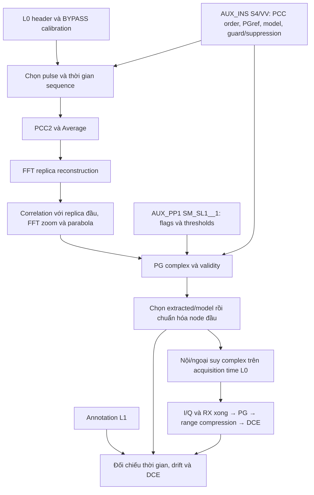

# Calibration L0 và PG drift tương đối — S1A/S4/VV

Khảo sát và triển khai ngày 21/10/2026 trên `product_1`, sau
[receiver compensation](sentinel1_receiver_gain_compensation.md). Đầu ra:
kiểm kê calibration, sơ đồ nguồn tham số, PG complex/validity và đối chứng
DCE. Đây là **bản nghiên cứu drift tương đối**, chưa phục hồi chuẩn hóa
radiometric tuyệt đối của IPF. DCE chỉ dùng khi có `--l0-pg-drift`.

## 1. Nguồn và công thức đã đối chiếu

- DAD Issue 2/5, §4.2.1.1–4.2.1.8 và §9.4. Đã mở trực tiếp PDF trang
  36–39 để kiểm tra PCC, replica reconstruction và chiều correlation/PG.
- [SPPDU Issue 13, §3.2.5.4](https://sentiwiki.copernicus.eu/__attachments/a_9797e243d30ccc6788b5f8c7ed5bf16a80346a0e542c654e693359edf0c34677/S1-IF-ASD-PL-0007%20-%20Sentinel-1%20SAR%20Space%20Packet%20Protocol%20Data%20Unit%202014%20-%2013.0.pdf):
  Range Decimation 0 có bandwidth 100 MHz nhưng **sample rate là
  3*F_REF = 112,60416672 MHz**. Không lấy con số “100 MHz” trong phần mô
  tả DAD làm sample rate khi xử lý packet thực tế.
- [Product Specification 3/16, pgProductAmplitude/pgProductPhase, PDF trang 159–160](https://sentiwiki.copernicus.eu/__attachments/a_19b24d9a39965738b9030586e95d8cae0fe3a26d0c571e5761848cef8ac2f9b4/S1-RS-MDA-52-7441%20-%20Sentinel-1%20Product%20Specification%202025%20-%203.16.1.pdf):
  annotation chứa `1/PG * sqrt(meanRxCalPow(1)/meanRxCalPow(n))`, trong
  đó PG là đáp ứng thiết bị. Do đó complex annotation đã chứa chiều
  correction; chuẩn hóa trực tiếp `annotation(t)/annotation(first)`.

**Lỗi nhánh tham chiếu cũ:** đã dùng `annotation(first)/annotation(t)`,
tức nghịch đảo thêm một lần. Nay sửa về chuẩn hóa trực tiếp. Test mới
khôi phục signal có đáp ứng thiết bị biết trước; không sinh input bằng
chính kết quả helper đang cần kiểm chứng. Các bảng reference/audit/RRF
cũ trước sửa PG và căn receiver phải đọc như số liệu lịch sử.

## 2. Kiểm kê dữ liệu thực tế

Có **28 acquisition chunk**, **800 calibration packet**, 16 noise packet
và 16.500 echo packet. Calibration ở BYPASS, không phải BAQ/FDBAQ; không
đưa I/Q bias hoặc receiver correction của echo vào các calibration pulse.

| Chunk | Nhóm | Loại theo Signal Type | Số packet mỗi chunk | Complex samples/packet |
|---|---|---|---:|---:|
| 0 | Noise đầu | Noise | 8 | 21.154 |
| 1, 21 | Image đầu/cuối | TxCal | 50 | 2.970 |
| 2, 22 | Image đầu/cuối | TxHCalIso | 50 | 2.970 |
| 3, 23 | Image đầu/cuối | RxCal | 50 | 2.970 |
| 4, 24 | Image đầu/cuối | EpdnCal | 50 | 2.970 |
| 5, 25 | Image đầu/cuối | TaCal | 50 | 2.970 |
| 6, 26 | Image đầu/cuối | ApdnCal | 50 | 2.970 |
| 7, 15 | PG đầu/cuối | TxCal | 12 | 5.946 |
| 8, 16 | PG đầu/cuối | TxHCalIso | 8 | 5.946 |
| 9, 17 | PG đầu/cuối | RxCal | 20 | 5.946 |
| 10, 18 | PG đầu/cuối | EpdnCal | 20 | 5.946 |
| 11, 19 | PG đầu/cuối | TaCal | 20 | 5.946 |
| 12, 20 | PG đầu/cuối | ApdnCal | 20 | 5.946 |
| 13, 14 | Echo | Echo | 11.550 / 4.950 | 21.154 |
| 27 | Noise cuối | Noise | 8 | 21.154 |

Image calibration dùng RGDEC 5 (56,30208336 MHz), PG dùng RGDEC 0
(112,60416672 MHz). Hai bộ PG đầy đủ ở chunk **7–12** và **15–20**.
ECC là “Stripmap 4 w/o interl.Cal”; không có node PG nội cảnh trong dữ
liệu này. Có đủ hai node bao echo để nội suy, không cần ngoại suy.

**Signal Type và Cal Type khác nhau:** dùng Signal Type để định tuyến.
Trong decoder hiện tại, Signal Type 11 là TaCal cho S1A/B, trong khi
chuỗi hiển thị Cal Type tương ứng có thể gọi TxCalIso do tên ghép theo
thế hệ vệ tinh. Signal Type 15 là TxHCalIso. Không chọn pulse theo chuỗi
Cal Type rồi tráo TA/isolation. TxH isolation được kiểm kê và dùng khi
xác định thời gian sequence; VV reconstruction không dùng Eq. 4-31 của TXH.

Adapter từ chối file ngoài S1A/S4/VV, header Error Flag, RX khác V,
calibration không BYPASS, gap packet trong chunk, timeline không tăng,
shape sai hoặc sequence thiếu/trùng loại pulse. Chưa triển khai sửa chữa
packet lỗi/thiếu; không tái đánh số pulse sau khi loại packet.

## 3. Nguồn tham số và pulse selection



AUX_INS record:
`internalCalibrationParamsList/internalCalibrationParams[swath=S4,polarisation=VV]`.

| Signal | Image `replicaPccParamsList` order | PG `pgPccParamsList` order | Method |
|---|---|---|---|
| TxCal | 50, 49 | 12, 11 | PCC2 |
| RxCal | 50, 49 | 20, 19 | PCC2 |
| EpdnCal | 50, 49 | 20, 19 | PCC2 |
| TaCal | 50, 49 | 20, 19 | PCC2 |
| ApdnCal | 43…50 | 13…20 | Average |

Order là **vị trí 1-based trong từng loại pulse của sequence**, không
phải packet ID hoặc Tx Pulse Number. Giữ nguyên thứ tự x/y do AUX cung
cấp. Eq. 4-29: `(pulse[x]-pulse[y])/2`; Eq. 4-30: trung bình đúng các
pulse được liệt kê. Không tự lấy hai pulse đầu hoặc cố định N=8 trong core.

AUX_PP1 `SM_SL1__1/preProcParams`:

| Cấu hình | Giá trị | Đầu vào API QC |
|---|---:|---|
| `performInternalCalibrationFlag` | true | Adapter chỉ dựng extracted khi được bật |
| `pgSource` | Extracted | `use_model=false` |
| `replicaThresholds/maxPgAmpStdFraction` | 1.000.000 | `pg_amp_std_fraction` |
| `replicaThresholds/maxPgPhaseStdFraction` | 1.000.000 | `pg_phase_std_fraction` |
| `replicaThresholds/maxPgAmpError` | 1.000.000 | `max_pg_amp_error` |
| `replicaThresholds/maxPgPhaseError` | 6,28 rad | `max_pg_phase_error` |
| `replicaThresholds/maxNumInvalidPgValFraction` | 1 | `invalid_pg_max_fraction` |

AUX_INS cung cấp complex `pgReference=707,945784384138+0j`, model
constant `0,87099+0j`, interval 6.500 s. XSD đặt node model đầu tại
ascending node của orbit. Vì LUT hiện tại hằng nên không cần đoán epoch;
adapter từ chối LUT không hằng cho tới khi có epoch L0 tường minh.

`deltaTGuard1=1,06568e−6 s`, `deltaTSuppr=1,06567992548971e−6 s`
được đọc từ AUX_INS để chẩn đoán delay Eq. 4-34. Header L0 cung cấp
sample rate, pulse length, ramp rate, start frequency và acquisition time.

## 4. Công thức và API

Pure core: `pre_processing/internal_calibration.py`; adapter nguồn:
`utils/pg_calibration_input.py`. Mọi cờ/ngưỡng/PCC selection đến từ caller
hoặc reader AUX; không chôn ngưỡng QC trong thuật toán.

1. `extract_pulse(decoded, *, order, method)` thực hiện PCC2/Average.
2. `reconstruct_replica(tx, rx, epdn, ta, apdn, *, denominator_relative_floor)`:
   `IFFT(FFT(tx)*FFT(rx)*FFT(ta)/(FFT(epdn)*FFT(apdn)))`, Eq. 4-32 cho
   co-pol VV tương tự HH. Spectral floor là guard nghiên cứu: gặp mẫu số
   quá nhỏ thì báo lỗi, không regularize để ép ra kết quả.
3. `correlation_peak(signal, reference, *, oversampling_factor)` thực hiện
   correlation FFT, zoom toàn miền bằng resample FFT, refine ba điểm bằng
   parabola magnitude; giữ complex peak tại vị trí refine. Trả signed lag.
4. `pg_products(replicas, *, pg_reference, oversampling_factor)` dùng
   replica đầu làm reference, `IFFT(FFT(rep_m)*conj(FFT(rep_first)))`, rồi
   `PGref/complex_peak`, Eq. 4-36/4-38 trước swath gain ratio.
5. `validate_pg(products, model, *, ...)` nhận tất cả threshold ở bảng
   trên và `use_model`. Relative QC dùng mean/std amplitude và phase
   unwrap theo thứ tự thời gian; absolute phase dùng circular distance.
   Đây là diễn giải rõ ràng cho phase wrap, chưa xác nhận cùng logic IPF.
6. `interpolate_pg(times_s, corrections, query_times_s)` nội suy/extrapolate
   tuyến tính complex Eq. 9-17. Không nội suy phase wrapped riêng. Phải có
   ít nhất hai node tăng nghiêm ngặt; correction zero/non-finite bị từ chối.

Relative outlier khi deviation **>** fraction*std; absolute invalid khi
deviation **>=** max error. Nếu invalid fraction **>** configured maximum
hoặc yêu cầu model, dùng model. Nếu không fallback thì chỉ chọn node valid;
thiếu hai node phải báo lỗi. Không tự thêm fallback trái cấu hình.

Tham số nghiên cứu chưa xác nhận IPF: FFT zoom factor **16**, spectral
denominator floor **0** (chỉ từ chối singular chính xác). Cả hai được
truyền tường minh qua API/CLI và ghi vào JSON, không tuning theo L1.

### Ranh giới absolute scale

Replica và correlation giữ raw FFT/DN units. PG tuyệt đối tương ứng khoảng
`1,80616e−7` và `1,82598e−7+j*7,92999e−9`; **không phải** các giá trị
engineering-unit đã chứng minh tương đương IPF. Kiểm tra absolute QC trên
những units này chỉ là gate số học theo threshold đang có; report đặt
`quality.absolute_scale_verified=false` và
`absolute_radiometric_scale_recovered=false`.

Threshold AUX của cảnh rất rộng; hai node qua QC **không chứng minh**
absolute calibration đúng. Chưa khôi phục gain ratio giữa swath từ image
calibration của swath tham chiếu. Mean RxCal power S4 được báo riêng:
44.798,7506734 đầu cảnh, 43.579,5936869 cuối cảnh.

Do đó chỉ áp `chosen_PG(t)/chosen_PG(first)` vào DCE. Một complex scale
và swath ratio **hằng** bị khử trong chuẩn hóa này; không bịa ratio để áp
absolute correction. Giữ chế độ opt-in cho tới khi xác nhận chuẩn hóa
replica/reference và absolute/model units theo tài liệu calibration chi tiết.

## 5. Kết quả kiểm kê và PG trên L0

Thời gian node là trung điểm từ packet đầu tới packet cuối của toàn PG
sequence, gồm isolation, theo §4.2.1.6. Không lấy thời gian node L1 làm input.

| Node | Chunks | Acquisition UTC | Relative correction | Delay diagnostic |
|---|---|---|---|---|
| Đầu | 7–12 | 2025-09-03T18:36:28.579689026 | 1+0j | 4,333081233e−7 s |
| Cuối | 15–20 | 2025-09-03T18:36:38.675628662 | 1,010973780175+j*0,043905163351 | 4,333096007e−7 s |

Hai node bao toàn echo; QC chọn cả hai, source extracted, invalid fraction
0. Timestamps cộng offset chẩn đoán L1 `0,335899 s` lệch annotation lần
lượt **0,238419 µs** và **0,715256 µs**, phù hợp độ phân giải time/float.
Offset này chỉ dùng đối chiếu, không đưa vào provider PG L0.

| Drift node cuối chuẩn hóa node đầu | L0/AUX | L1 annotation chuẩn hóa trực tiếp |
|---|---:|---:|
| Amplitude | 1,011926700691 | 1,011265091494 |
| Phase [rad] | 0,043401315716 | 0,043374000000 |

Chênh amplitude khoảng **0,0654%** tương đối; chênh phase
**2,73157e−5 rad**. Không sửa hệ số hay order để khớp L1.
Correlation thêm với nominal chirp được ghi **chỉ để chẩn đoán**:
dùng mean-correlation normalization 1/N, lag khoảng 48,7923 sample,
inverse peak gần complex pgProduct trong L1. Nó không thay reference
đầu tiên trong thuật toán drift và không chốt absolute normalization IPF.

## 6. Tái chạy và đối chứng DCE

```bash
MPLBACKEND=Agg /home/xiaoxin/python_envs/sentinel1/bin/python \
  workflows/sentinel-1/analyze_calibration.py

MPLBACKEND=Agg OPENBLAS_NUM_THREADS=2 /home/xiaoxin/python_envs/sentinel1/bin/python \
  workflows/sentinel-1/estimate_doppler_centroid.py --l0-pg-drift \
  --output output/sentinel-1/pg_calibration/dce_l0_pg

MPLBACKEND=Agg OPENBLAS_NUM_THREADS=2 /home/xiaoxin/python_envs/sentinel1/bin/python \
  workflows/sentinel-1/estimate_doppler_centroid.py --l1-input-corrections --l0-raw-analysis \
  --output output/sentinel-1/pg_calibration/dce_reference_pg

MPLBACKEND=Agg OPENBLAS_NUM_THREADS=2 /home/xiaoxin/python_envs/sentinel1/bin/python \
  workflows/sentinel-1/estimate_doppler_centroid.py --l1-input-corrections --l0-raw-analysis --l0-pg-drift \
  --output output/sentinel-1/pg_calibration/dce_reference_l0_pg
```

Inventory tại `output/sentinel-1/pg_calibration/calibration.json`, biểu đồ
`pg_drift.png`. CLI nhận `--oversampling-factor`,
`--denominator-relative-floor`; demo DCE nhận `--pg-oversampling-factor`,
`--pg-denominator-relative-floor`. Default output DCE thêm suffix
`_l0_pg_drift` khi bật để giữ baseline. Không ghi calibration/raw vào Git.

Provider PG L0 dùng acquisition time trực tiếp, sau I/Q/RX và trước range
compression. Khi dùng cùng reference mode, provider **thay** PG L1, không
nhân cả hai. Các hiệu chỉnh khác, bias L0, RMS threshold và estimator giữ nguyên.

| Input / block | Fine DC/L1 RMSE [Hz] | Polynomial/L1 RMSE [Hz] | Fit RMS [Hz] |
|---|---:|---:|---:|
| Default chưa PG / 1 | 1,362630627 | 1,331278012 | 1,424903422 |
| Default + PG L0 / 1 | 1,368015773 | 1,337021940 | 1,426143713 |
| Default chưa PG / 2 | 1,451727677 | 1,410532531 | 1,213715114 |
| Default + PG L0 / 2 | 1,447718844 | 1,406317619 | 1,215300759 |
| Reference, PG L1 đã sửa chiều / 1 | 1,381618820 | 1,352807537 | 1,419864348 |
| Reference, PG L0 thay PG L1 / 1 | 1,381968651 | 1,353182441 | 1,419935983 |
| Reference, PG L1 đã sửa chiều / 2 | 1,487424177 | 1,443424527 | 1,208615493 |
| Reference, PG L0 thay PG L1 / 2 | 1,487252277 | 1,443239909 | 1,208701434 |

So default có/không PG: cùng ROI 18.170 mẫu, 20 block ×1.000, azimuth
`[0,6000)`, `[10500,16500)`. Fine DC thay đổi max **0,012819801 Hz** /
**0,011034113 Hz**. Đối chứng reference dùng cùng ROI 18.145 sau delay
guard; PG L0 so PG L1 thay đổi max **0,000797642 Hz** /
**0,000553644 Hz**, RMS **0,000481687 Hz** / **0,000279169 Hz**.

Cả ba lượt mới đều ambiguity 0, chọn data, fit RMS <20 Hz. Thay đổi PG
nhỏ so với residual DCE cỡ Hz; không kết luận nó giải thích phần residual
còn lại. Không dùng RMSE để đổi PCC order, ngưỡng hoặc chiều correction.
Các metadata mô tả PG trong JSON đã được chỉnh sau lượt chạy khi hoàn
thiện report; các mảng số DCE được kiểm tra giữ nguyên và có note tường minh.

## 7. Kiểm thử và phần chưa hoàn thiện

`test/test_internal_calibration.py`: **17 test**, gồm 16 synthetic/API và
1 integration trên L0 thật. Các đối chứng gồm PCC loại leakage và đảo
order; Average đúng selection; FFT transfer function biết trước; singular
support; lag fractional có dấu và complex peak; inverse instrument gain;
scale hằng bị khử; relative/absolute QC và model fallback; phase wrap;
interpolation/extrapolation; input/config lỗi; drift correction trả đúng
tone 7 Hz. Oracle L0 thật tự chọn pulse, dùng NumPy FFT và tìm fractional
peak bằng Fourier evaluation cục bộ độc lập với thuật toán parabola.

Thêm 1 integration trong `test/test_raw_data_analysis.py` (24 test tổng):
provider caller thay PG reference đúng một lần; PG zero/NaN/shape sai
bị chặn trước FFT. Test PG reference hiện có được sửa để dùng mô hình
thiết bị biết trước, bảo vệ chiều direct normalization.

Full suite: **118 test, 112 đạt, 4 skip, 2 lỗi** thiếu XML S6 cũ.

Chưa xác nhận absolute PG/model units hoặc swath gain ratio; chưa có
full replica validation/quality và image coefficient extraction giống IPF;
chưa hỗ trợ repair/drop calibration sequence lỗi rồi chọn reference mới;
model LUT không hằng cần ascending-node epoch. Chưa đưa PG này vào
default hoặc notebook focus S6, chưa chạy lại toàn ma trận audit/RRF.
Đây là các khoảng thiếu được ghi nhận, không phải các bước đã hoàn thành.
